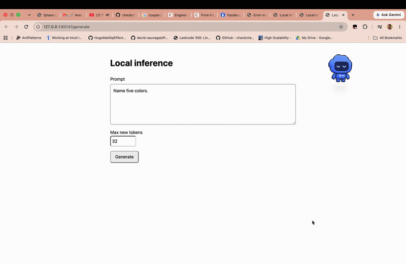

# Mac inference lab

Build up a local language model server one step at a time. The finished lab
runs Qwen2.5-0.5B-Instruct on an M3 Mac with 16 GB of memory, accepts concurrent
HTTP requests, and streams answers to a browser. It uses pretrained weights
and runs inference locally.



[Download the full recording (.mov)](demo/final_inference.mov?raw=true)

## Run the finished demo

Clone the repo and set up a Python 3.12 environment.

```sh
git clone https://github.com/maksood1920/inference.git
cd inference
python3.12 -m venv .venv
.venv/bin/python -m pip install -r requirements-lock.txt
.venv/bin/python run.py --device cpu --max-new-tokens 1
```

The last command downloads the pinned checkpoint into `.cache` (about 1 GB)
and runs a small check with Transformers. The server loads that checkpoint
from disk.

```sh
.venv/bin/python serve.py --device mps --port 0
```

Open the URL printed after `Listening on`. The server chooses a free port and
serves the form at both `/` and `/generate`. Use `--device cpu` if MPS is
unavailable. Paste this prompt, set **Max new tokens** to **256**, and click
**Generate**.

> My 4-year-old daughter loves exploring. Give me three simple activities we can do together at home or outside. Use one sentence per activity and no introduction.

The answer appears as it is generated. At the end, the page shows the token
count, stop reason, server-side time to first token, and scheduling rounds.
`eos` means the model emitted an end-of-sequence token. `token_limit` means it
used the output budget and may have stopped mid-sentence.

## How we built it

### 1. Watch a model generate one token at a time

`run.py` starts with Transformers' `model.generate` as a reference. Its
explicit loop runs the model on the prompt, picks the highest-scoring next
token, and feeds that token back into the model to predict another. It stops
at EOS or the output limit. This gave us a known output to check as we
replaced parts of the implementation.

```sh
.venv/bin/python run.py --offline --device mps --compare-no-cache
```

### 2. Build the model forward pass

In `engine.py`, we use the same pretrained weights and implement the Qwen
forward pass with PyTorch operations. A forward pass turns token IDs into
scores for the next token. The code covers embeddings, rotary positions,
grouped-query causal attention, normalization, and the feed-forward layers.

The validator checks model scores and generated token IDs against Transformers.
It tests causality by changing future tokens while keeping the input shape
fixed. Earlier scores should stay the same. The separate cross-length check
records rounding differences when the input shape changes. [Forward pass walkthrough](FORWARD_PASS.md) · [Validation notes](VALIDATION_UPDATE.md)

```sh
.venv/bin/python -m unittest -v test_engine.py
.venv/bin/python validate_engine.py --device mps --output /tmp/engine-validation.json
```

### 3. Save past keys and values

During **prefill**, the engine processes the whole prompt, saves each layer's
keys and values in the KV cache, and selects the first output token. During
**decode**, it feeds that selected token into the model, adds its keys and
values to the cache, and predicts the next token. The current query attends
to the saved history. The query is used in that step, and the keys and values
are kept for later steps.

```sh
.venv/bin/python run_engine.py --device mps --compare-cache --output /tmp/own-cache.json
```

### 4. Generate for two prompts in one batch

We first batched a short question that answers **Paris** and a longer request
to **name five colors**. They share model calls while both are active. Each
request has its own token positions and KV history. The engine masks prompt
padding and removes finished rows. In this static batch, admission happens
once at the start.

```sh
.venv/bin/python run_batch.py --device mps --output /tmp/static-batch.json
```

### 5. Refill a slot while the batch is running

We added a third prompt about the KV cache and set a limit of two active
requests. Paris finishes in round 1 and the queued prompt runs prefill in
round 2. Colors keeps generating through round 26. After prefill, the two
active requests share decode calls. This is **continuous batching**.

```sh
.venv/bin/python run_batch.py --continuous --device mps --output /tmp/continuous-batch.json
```

This implementation packs each request's compact cache into a temporary padded
batch for decode. Copying caches adds work, and a new prompt's prefill runs in
a separate model call during its admission round.

### 6. Accept live requests and stream the answers

`serve.py` keeps one model worker running with two active slots and a FIFO
queue for up to 16 waiting requests. A full queue returns HTTP 503. The browser
form in `generate.html` submits a prompt to `POST /generate` and reads
Server-Sent Events (SSE) as the worker advances through generation rounds.
Each `text` event contains the current decoded answer. The `done` event
contains the final text, token IDs, stop reason, rounds, and timing. An
`error` event reports a failure after streaming starts.

To see the events in a terminal, substitute the port printed by your server.
Omit the `stream` field to get one JSON response after generation finishes.

```sh
curl -N http://127.0.0.1:8000/generate \
  -H 'Content-Type: application/json' \
  -d '{"prompt":"Name five colors.","max_new_tokens":32,"stream":true}'
```

## Try continuous batching over HTTP

Replace `8000` below with the port printed by your server. The three
background requests are submitted together. Each prints its admission and
finish rounds when it completes.

```sh
(
  url=http://127.0.0.1:8000/generate
  send() {
    curl -fsS "$url" -H 'Content-Type: application/json' -d "$2" |
      .venv/bin/python -c '
import json, sys
result = json.load(sys.stdin)
start = result["admitted_round"]
end = result["finished_round"]
print(f"{sys.argv[1]}  rounds {start}–{end}")
' "$1"
  }

  send story '{"prompt":"Write a long story about a dragon learning to fly.","max_new_tokens":256}' &
  send paris '{"prompt":"What is the capital of France? Answer with only the city name.","max_new_tokens":8}' &
  send cache '{"prompt":"Explain how a KV cache works in three paragraphs.","max_new_tokens":128}' &
  wait
)
```

In one M3 run, Paris and the story started in round 583. Paris finished in
584, the cache explanation started in 585, and the story continued through
838. HTTP arrival order can vary. Look for a waiting request taking a slot
after another finishes while the remaining request is still generating.

## What we measured

| Experiment | Device | Tokens/s | Comparison | Report |
|---|---|---:|---:|---|
| Single request with KV cache | M3 GPU | 53.33 | 24.21 without cache | [KV cache](results/own-cache-mps.json) |
| Static batch | M3 GPU | 54.84 | 52.72 sequential | [Static batch](results/batch-mps.json) |
| Continuous batch | M3 GPU | 74.34 | 53.27 sequential | [Continuous batch](results/continuous-mps.json) |
| Continuous batch | CPU | 23.88 | 26.28 sequential | [CPU run](results/continuous-cpu.json) |

Generated token IDs matched the corresponding comparison runs on these
prompts. Each row describes its own workload. Rates include generation and
exclude model loading. The batch rates count tokens across all requests.
Server-side time to first token includes queueing, tokenization, and prefill
through first-token selection. It ends before browser rendering.

The lab accepts prompts up to 512 tokens including the chat template and
outputs up to 256 tokens. MPS uses float16 and CPU uses float32. The batch
runners accept `--device cpu` as well. The server keeps the queue and KV caches
in memory and listens on localhost.

## References

- [Qwen2.5-0.5B-Instruct model and license](https://huggingface.co/Qwen/Qwen2.5-0.5B-Instruct)
- [PyTorch MPS backend](https://docs.pytorch.org/docs/stable/notes/mps.html)
- [Transformers generation interface](https://huggingface.co/docs/transformers/en/main_classes/text_generation)
